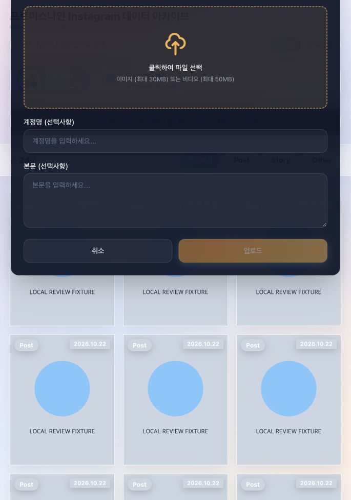

# 디자인·UX·접근성 개선

검토일: 2026-10-23 (Asia/Seoul) · 기준 커밋: 9fdacb893e287498387a3abf9e5ce38f42ece762 (최신 main)

[범위·검증 결과·우선순위 요약](README.md) · [기능 리뷰](01-functionality.md) · [보안 리뷰](02-security.md)

9개 항목을 결함과 선택적 개선으로 구분했습니다. 실제 화면 확인은 로컬 Vite + 합성 API fixture, IAB 685×975 화면에서 진행했습니다. 운영 콘텐츠·실계정 로그인·모바일 기기는 사용하지 않았습니다. 디자인 취향과 접근성 결함을 같은 수준의 오류로 취급하지 않았습니다.

**최신화 검증:** 디자인 지적의 근거 파일 8개는 adc0768과 최신 main에서 동일합니다. 프론트 변경은 image.ts의 썸네일 기본 도메인뿐이며 UI 배치·스타일·키보드 처리는 바뀌지 않아 9개 항목을 유지했습니다. 첨부 화면은 최초 리뷰 adc0768에서 촬영한 합성 데이터 화면이며, 이번 최신화에서 다시 촬영하지 않았습니다.

## D-01 · P2 · 업로드 모달의 제목·닫기 버튼이 화면 위로 잘림

분류: 결함 · 브라우저 재현 · 확신도 10/10

근거: [frontend/src/components/layout/AppShell.tsx:50](https://github.com/angelos0424/fromistargram/blob/9fdacb893e287498387a3abf9e5ce38f42ece762/frontend/src/components/layout/AppShell.tsx#L50), [frontend/src/components/layout/AppShell.tsx:65](https://github.com/angelos0424/fromistargram/blob/9fdacb893e287498387a3abf9e5ce38f42ece762/frontend/src/components/layout/AppShell.tsx#L65), [frontend/src/components/filter/FiltersPanel.tsx:71](https://github.com/angelos0424/fromistargram/blob/9fdacb893e287498387a3abf9e5ce38f42ece762/frontend/src/components/filter/FiltersPanel.tsx#L71), [frontend/src/components/common/UploadModal.tsx:90](https://github.com/angelos0424/fromistargram/blob/9fdacb893e287498387a3abf9e5ce38f42ece762/frontend/src/components/common/UploadModal.tsx#L90)

**문제:** fixed 모달이 backdrop-filter가 있는 필터 상자 안에 렌더링됩니다. 뷰포트가 아닌 조상 영역을 기준으로 배치되고, 모달 자체에도 최대 높이와 내부 스크롤 제한이 없습니다.

**확인 수준:** 로컬 fixture의 685×975 화면에서 업로드를 열자 제목과 우측 닫기 버튼이 화면 위로 잘렸습니다. 초기 빈 업로드 상태에서도 발생했습니다. 아래 캡처는 합성 데이터이며 운영 화면이 아닙니다.

**개선안:** 모달을 document.body에 포털로 렌더링하고 모든 화면에서 최대 높이를 뷰포트에 맞춥니다. 제목·하단 액션은 유지하고 본문·미리보기만 내부 스크롤되도록 구성합니다.

**완료 기준:** 685×975 재현 조건과 390×844, 844×390, 200% 확대, 다수 파일 선택에서 제목·취소·업로드 버튼에 접근 가능해야 합니다. 뒤의 세 조건은 후속 검증 기준이며 이번에 실행하지 않았습니다.

## D-02 · P2 · 업로드 모달의 키보드·스크린리더 동작 누락

분류: 접근성 결함 · 브라우저·소스 확인 · 확신도 10/10

근거: [frontend/src/components/common/UploadModal.tsx:89](https://github.com/angelos0424/fromistargram/blob/9fdacb893e287498387a3abf9e5ce38f42ece762/frontend/src/components/common/UploadModal.tsx#L89)

**문제:** 일반 div에 대화상자 역할·제목 연결·초기 포커스·포커스 순환·Escape 처리가 없습니다. 닫기 아이콘도 접근 가능한 이름이 없습니다.

**확인 수준:** 모달을 연 뒤 포커스가 배경의 업로드 버튼에 남았습니다. Escape를 눌러도 모달과 접근성 트리가 바뀌지 않았습니다.

**개선안:** 공통 Dialog에서 제목 연결, 초기 포커스, Tab 순환, Escape 닫기, 호출 버튼으로 포커스 복귀를 처리합니다. 닫기 아이콘에 명확한 이름을 부여합니다. 상호작용 기준은 [W3C Modal Dialog Pattern](https://www.w3.org/WAI/ARIA/apg/patterns/dialog-modal/)을 따릅니다.

**완료 기준:** 키보드만으로 열기 → 파일 선택 → 취소/닫기가 가능하고, 열려 있는 동안 배경 UI로 포커스가 나가지 않아야 합니다.

## D-03 · P2 · 중첩 모달에서 부모의 키보드 처리와 충돌

분류: 접근성 결함 · 정적 확인 · 확신도 9/10

근거: [frontend/src/components/feed/PostModal.tsx:68](https://github.com/angelos0424/fromistargram/blob/9fdacb893e287498387a3abf9e5ce38f42ece762/frontend/src/components/feed/PostModal.tsx#L68), [frontend/src/components/feed/PostModal.tsx:78](https://github.com/angelos0424/fromistargram/blob/9fdacb893e287498387a3abf9e5ce38f42ece762/frontend/src/components/feed/PostModal.tsx#L78), [frontend/src/components/feed/PostModal.tsx:346](https://github.com/angelos0424/fromistargram/blob/9fdacb893e287498387a3abf9e5ce38f42ece762/frontend/src/components/feed/PostModal.tsx#L346), [frontend/src/components/feed/PostModal.tsx:374](https://github.com/angelos0424/fromistargram/blob/9fdacb893e287498387a3abf9e5ce38f42ece762/frontend/src/components/feed/PostModal.tsx#L374)

**문제:** 부모는 dialogRef 내부에 Tab 순환을 걸지만 프로필 히스토리·전체화면은 그 바깥에 렌더링됩니다. Escape 분기는 전체화면만 구분하고 프로필 히스토리는 구분하지 않습니다.

**확인 수준:** 프로필 히스토리가 열려도 Escape가 게시물 onClose를 호출하는 코드 경로를 확인했습니다. 중첩 화면의 포커스 이동·최상위 대화상자 의미도 별도로 정의되지 않았습니다. 실제 해당 화면의 키보드 재현은 하지 않았습니다.

**개선안:** 최상단 Dialog만 포커스와 Escape를 처리하는 구조로 통합합니다. 하위 창을 닫으면 부모의 호출 요소로 복귀하고 게시물 변경 시 하위 창 상태를 초기화합니다.

**완료 기준:** 게시물 → 프로필 히스토리 → Escape에서 프로필 창만 닫혀야 하며, 전체화면에서도 보이는 최상단 UI만 Tab 순회해야 합니다.

일반 PostModal/SharedMediaModal에는 내부 캐러셀의 초기 포커스 코드가 있어, 일반 상세 모달 전체에 초기 포커스가 없다는 주장은 제외했습니다.

## D-04 · P2 · 파스텔 버튼 위 흰 글자의 대비 부족

분류: 가독성 결함 · 색상 수치 계산 · 확신도 9/10

근거: [frontend/src/components/account/AccountStrip.tsx:23](https://github.com/angelos0424/fromistargram/blob/9fdacb893e287498387a3abf9e5ce38f42ece762/frontend/src/components/account/AccountStrip.tsx#L23), [frontend/src/routes/FeedPage.tsx:503](https://github.com/angelos0424/fromistargram/blob/9fdacb893e287498387a3abf9e5ce38f42ece762/frontend/src/routes/FeedPage.tsx#L503), [frontend/src/routes/FeedPage.tsx:537](https://github.com/angelos0424/fromistargram/blob/9fdacb893e287498387a3abf9e5ce38f42ece762/frontend/src/routes/FeedPage.tsx#L537), [frontend/src/components/filter/FiltersPanel.tsx:66](https://github.com/angelos0424/fromistargram/blob/9fdacb893e287498387a3abf9e5ce38f42ece762/frontend/src/components/filter/FiltersPanel.tsx#L66)

**문제:** 활성 계정·정렬·분류·업로드 버튼의 작은 흰 글자가 밝은 그라데이션 위에 배치됩니다.

**확인 수준:** 소스의 불투명 색상과 흰색을 계산하면 #7EC8FF 1.81:1, #8CE8D0 1.44:1, #B8A4F0 2.19:1입니다. 실제 반투명 합성 픽셀을 측정한 값은 아닙니다. 일반 크기 텍스트의 4.5:1 기준은 [WCAG 2.2 Contrast Minimum](https://www.w3.org/WAI/WCAG22/Understanding/contrast-minimum)을 참고했습니다.

**개선안:** 파스텔 배경에 #2D3748 글자를 쓰면 같은 색상 기준 6.62:1 / 8.32:1 / 5.48:1로 개선됩니다. 흰 글자를 유지하는 CTA는 배경을 더 진하게 정합니다.

**완료 기준:** 활성·hover·focus·다크 모드의 실제 합성 색상으로 대비를 확인합니다. 비활성 버튼은 활성 버튼과 구분해서 평가합니다.

## D-05 · P2 · 선택 상태·입력 이름·포커스 표시가 충분하지 않음

분류: 접근성 결함 · 정적/접근성 트리 확인 · 확신도 9/10

근거: [frontend/src/components/account/AccountStrip.tsx:20](https://github.com/angelos0424/fromistargram/blob/9fdacb893e287498387a3abf9e5ce38f42ece762/frontend/src/components/account/AccountStrip.tsx#L20), [frontend/src/routes/FeedPage.tsx:472](https://github.com/angelos0424/fromistargram/blob/9fdacb893e287498387a3abf9e5ce38f42ece762/frontend/src/routes/FeedPage.tsx#L472), [frontend/src/routes/FeedPage.tsx:500](https://github.com/angelos0424/fromistargram/blob/9fdacb893e287498387a3abf9e5ce38f42ece762/frontend/src/routes/FeedPage.tsx#L500), [frontend/src/routes/FeedPage.tsx:533](https://github.com/angelos0424/fromistargram/blob/9fdacb893e287498387a3abf9e5ce38f42ece762/frontend/src/routes/FeedPage.tsx#L533), [frontend/src/components/filter/FiltersPanel.tsx:34](https://github.com/angelos0424/fromistargram/blob/9fdacb893e287498387a3abf9e5ce38f42ece762/frontend/src/components/filter/FiltersPanel.tsx#L34)

**문제:** 계정·정렬·분류의 활성 여부가 CSS 색상에만 담겨 있습니다. 검색은 placeholder만 있고 명시적 이름이 없으며, 날짜 필드는 outline-none을 대체하는 포커스 표시가 없습니다.

**확인 수준:** 로컬 접근성 트리에서 검색은 이름 없는 search text field로 표시됐고 선택 버튼에는 선택 상태가 전달되지 않았습니다.

**개선안:** 선택형 버튼에 aria-pressed 또는 적절한 라디오 패턴을 적용합니다. 검색에 label 또는 aria-label을 추가하고 날짜 입력에도 focus-visible 표시를 제공합니다. 탭 패턴을 선택한다면 패널 연결과 키보드 규칙까지 구현합니다.

**완료 기준:** 스크린리더로 현재 계정·정렬·분류를 알 수 있고, 마우스 없이 모든 입력의 현재 포커스를 확인할 수 있어야 합니다.

## D-06 · P2 · 파일 삭제 버튼이 hover에만 보임

분류: 접근성·터치 발견성 결함 · 정적 확인 · 확신도 9/10

근거: [frontend/src/components/common/upload/PreviewGrid.tsx:25](https://github.com/angelos0424/fromistargram/blob/9fdacb893e287498387a3abf9e5ce38f42ece762/frontend/src/components/common/upload/PreviewGrid.tsx#L25)

**문제:** 삭제 버튼은 `opacity-0 group-hover:opacity-100`이고 focus-visible/focus-within 표시와 aria-label이 없습니다.

**확인 수준:** 키보드로 도달할 수 있는 버튼이 hover가 없을 때 투명하게 남는 스타일 조건을 확인했습니다. 실제 터치 기기에서의 동작은 미검증입니다.

**개선안:** 터치 환경에서는 항상 노출하고, 데스크톱에서도 hover와 focus 양쪽에서 표시합니다. 파일명을 포함한 삭제 버튼 이름과 충분한 터치 영역을 제공합니다.

**완료 기준:** 마우스를 움직이지 않고 각 파일의 삭제 위치·이름·포커스를 확인하고 원하는 파일만 제거할 수 있어야 합니다.

## D-07 · P2 · 관리자 레이아웃의 모바일 전환 필요

분류: 반응형 결함 후보 · 정적 치수 확인 · 확신도 7/10

근거: [frontend/src/components/admin/AdminLayout.tsx:47](https://github.com/angelos0424/fromistargram/blob/9fdacb893e287498387a3abf9e5ce38f42ece762/frontend/src/components/admin/AdminLayout.tsx#L47), [frontend/src/components/admin/AdminLayout.tsx:48](https://github.com/angelos0424/fromistargram/blob/9fdacb893e287498387a3abf9e5ce38f42ece762/frontend/src/components/admin/AdminLayout.tsx#L48), [frontend/src/components/admin/AdminLayout.tsx:70](https://github.com/angelos0424/fromistargram/blob/9fdacb893e287498387a3abf9e5ce38f42ece762/frontend/src/components/admin/AdminLayout.tsx#L70)

**문제:** 모든 화면에서 좌우 flex이며 사이드바가 w-56 flex-shrink-0입니다. main에 min-w-0도 없습니다.

**확인 수준:** 390px 폭에서 좌우 여백 48px, 사이드바 224px, 간격 32px를 제외하면 본문에 86px만 남는 구조입니다. 실제 관리자 로그인 화면의 렌더링은 확인하지 않았으므로 스크린샷 기반 확정과 구분합니다.

**개선안:** 작은 화면에서는 상단 탭이나 접이식 메뉴로 바꾸고 큰 화면에서만 2열을 유지합니다. 본문에 min-w-0를 적용하고 표 자체에 가로 스크롤을 둡니다.

**완료 기준:** mock 인증 상태의 390px 화면에서 폼과 주요 액션을 조작할 수 있고 페이지 전체의 불필요한 가로 스크롤이 없어야 합니다.

## D-08 · P3 · 고정 헤더의 밀도를 줄여 자료를 볼 공간 확보

분류: 선택적 디자인 개선 · 사용자 테스트 전 제안

근거: [frontend/src/components/layout/AppShell.tsx:50](https://github.com/angelos0424/fromistargram/blob/9fdacb893e287498387a3abf9e5ce38f42ece762/frontend/src/components/layout/AppShell.tsx#L50)

**문제:** 제목·검색·계정 목록·날짜 필터 전체가 sticky입니다. 로컬 685px 화면에서도 미디어 목록 위에 여러 줄의 도구가 쌓입니다.

**확인 수준:** 로컬 화면에서 현재 구조를 확인했습니다. 작은 화면·가로 화면의 점유율은 별도 측정이 필요합니다.

**개선안:** 제목/검색만 고정하고 계정·날짜는 스크롤되게 하거나, 필터 접기와 현재 조건 요약을 제공합니다. 필터가 적용됐다는 상태는 항상 남깁니다.

**완료 기준:** 기존 화면과 비교해 동일 뷰포트에서 보이는 미디어 면적, 계정 전환·날짜 변경의 조작 횟수를 확인합니다.

## D-09 · P3 · 분류명과 공통 UI 규칙 정리

분류: 선택적 디자인 개선 · 제품 용어 제안

근거: [frontend/src/routes/FeedPage.tsx:521](https://github.com/angelos0424/fromistargram/blob/9fdacb893e287498387a3abf9e5ce38f42ece762/frontend/src/routes/FeedPage.tsx#L521), [frontend/src/components/admin/AdminLayout.tsx:29](https://github.com/angelos0424/fromistargram/blob/9fdacb893e287498387a3abf9e5ce38f42ece762/frontend/src/components/admin/AdminLayout.tsx#L29)

**문제:** 분류명이 전체보기/Post/Story/Other로 섞여 있고 Other가 공유 업로드 자료라는 의미를 바로 전달하지 않습니다. 공개·관리 화면의 버튼과 입력 규칙도 서로 다릅니다.

**확인 수준:** 문구와 스타일 정의를 대조했습니다. 서로 다른 시각 스타일 자체를 오류로 판단하지는 않았습니다.

**개선안:** “전체 / 게시물 / 스토리 / 공유 미디어”처럼 의미가 드러나는 명칭을 검토합니다. 버튼·입력·상태 색·간격을 공통 토큰으로 정의하되 관리 화면의 정보 밀도는 별도로 조절합니다.

**완료 기준:** 처음 방문한 사용자가 공유 업로드 자료 위치를 찾을 수 있는지 확인하고, 공통 컴포넌트의 상태·포커스·오류 표시를 통일합니다.

## 적용 순서

모달의 배치·키보드 동작(D-01~03), 글자 대비·선택 상태·삭제 버튼(D-04~06)을 먼저 수정하고 관리자 반응형(D-07)을 검증합니다. 고정 헤더와 용어 정리(D-08~09)는 그 다음 화면 사용성을 비교하며 진행하는 것이 좋습니다. 검색 범위, 파일 추가, 장애 상태는 기능 문서 F-06~08에서 다뤘습니다.

