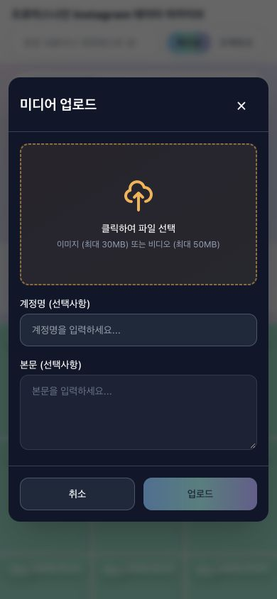
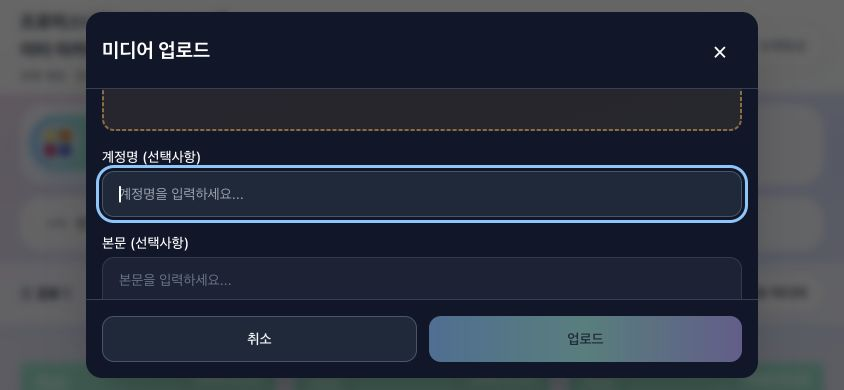
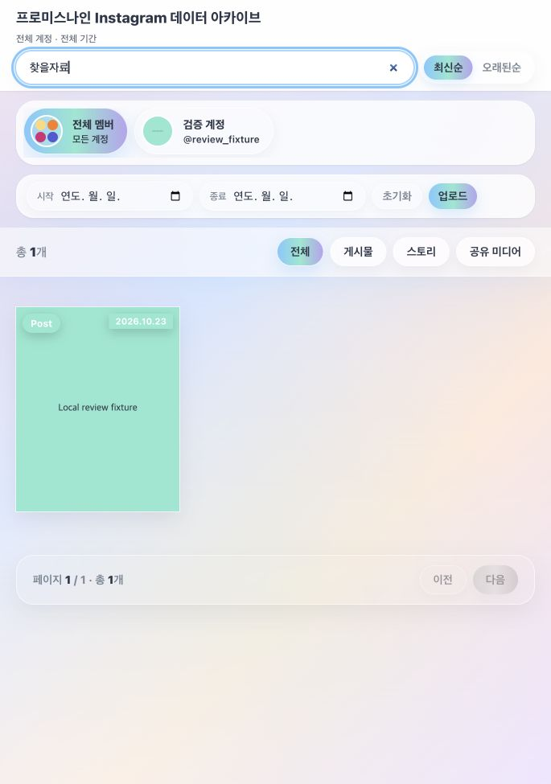
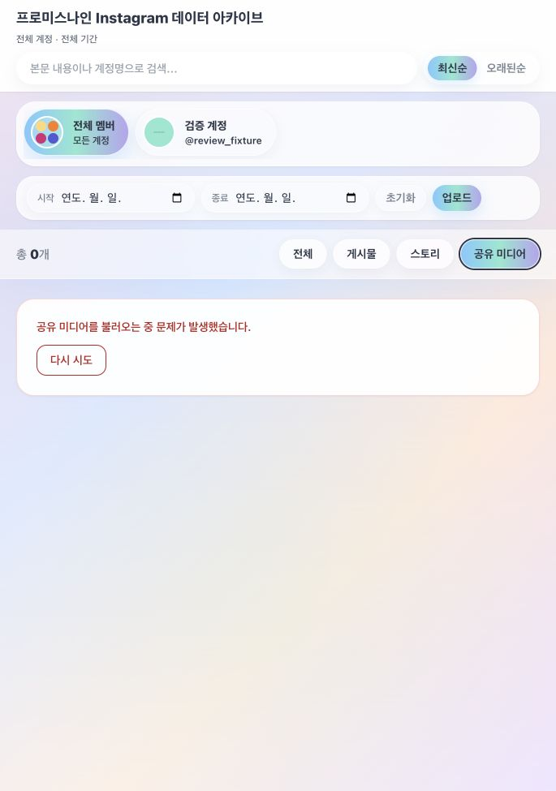
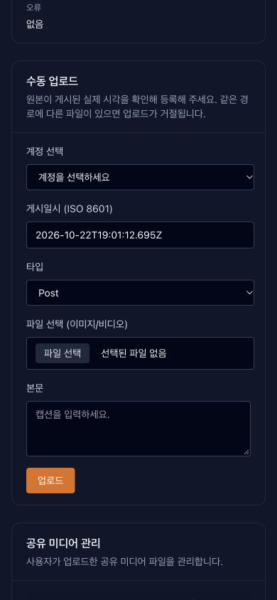

# 리뷰 수정 결과

작업일: 2026-10-23 (Asia/Seoul). 수정 PR: [#87](https://github.com/angelos0424/fromistargram/pull/87). 리뷰 문서 PR #57이 병합된 main `4f83443`을 기준으로 `codex/review-fixes-20261023`에서 수정했습니다. [29개 이슈별 목록](05-remediation-tracker.md)의 구현을 완료했으며, 코드 병합·운영 배포는 별도 단계입니다.

## 우선순위별 변경

| 순서 | 항목 | 변경 |
|---|---|---|
| P1 | SEC-01, SEC-03, SEC-05 | 관리자 역할의 정확한 일치, issuer·audience·sub·exp 검증, 설정 누락 시 관리자 API 503 |
| P1 | SEC-02, F-02, SEC-04, SEC-06 | 업로드 MIME·확장자·시그니처 검사, 안전한 미디어 응답, 스트리밍 임시 저장, 개수·합산·동시성 제한, 실계정·실경로 검사, 원본 충돌 409·배타적 생성 |
| P1 | F-01 | 계정을 포함한 새 게시물 ID, 기존 소유자의 timestamp-only ID 보존, 타계정 alias 차단, 재인덱싱 시 소스 기준 오염 복구 |
| P1 | SEC-07 | Node 20 Docker 기반을 24.22.1 LTS로 갱신, .nvmrc·패치 버전 engines 명시, Node 22.23.4/24.22.1 CI와 컨테이너 빌드 검증 추가 |
| P2 | F-03~08, F-13 | KST 날짜 범위, 관리자 meta cursor와 서버의 안정적 정렬, Story 응답 ID, 전체 검색과 총개수, 파일 추가 유지, 장애 재시도, 대소문자 계정 조회 |
| P2 | D-01~07 | 포털 Dialog·최상단 포커스·Escape·배경 inert, 내부 스크롤, 대비·선택 상태·입력 이름·포커스, 보이는 파일 삭제, 모바일 관리자 배치 |
| P3 | F-09~12, D-08~09 | 실제 게시물 수, 원본 주소 복사, DOM 테스트 수정, 도메인 통일, 축소 고정 헤더·현재 필터 요약, 한글 분류와 공통 UI 토큰 |

표의 P1 묶음에는 같은 인증·업로드 경계에서 함께 수정한 관련 P2 항목도 포함합니다. 서버와 클라이언트의 업로드 조건, 검색 query, 페이지네이션 응답을 함께 확인했습니다.

## 검증 결과

격리된 공식 **Node 24.22.1 (macOS arm64)** 바이너리의 SHA-256을 공식 릴리스와 대조했습니다. 시스템 전역 Node는 변경하지 않았습니다.

| 검증 | 결과 |
|---|---|
| pnpm install --frozen-lockfile | 통과, lockfile 변경 없음 |
| Prisma client generate | 통과, 운영 DB 쿼리·마이그레이션 실행 없음 |
| pnpm -r lint | 프론트·백엔드 타입 검사 통과 |
| pnpm -r test --run | 백엔드 **93/93**, 프론트 **14/14**, 총 **107개 통과** |
| pnpm -r build | 프론트·백엔드 통과 |
| 교차 코드 리뷰 | 계정 ID 계약, legacy ID·alias, 업로드 lock/rollback, cursor·정렬·count 검토 및 보완 |
| Docker 이미지 태그 | node:24.22.1-alpine 다중 아키텍처 manifest 존재 확인 |
| 로컬 Docker 실행 | 데몬 미실행으로 이미지 빌드·컨테이너 구동 미실시. [원격 CI](https://github.com/angelos0424/fromistargram/actions/runs/39837218043)에서 이미지 빌드·Node 버전 실행 확인 통과 |

기존 프론트 Pagination 실패를 고쳤으며, 재설치 뒤 드러난 Vitest 2/4의 matcher 등록 충돌도 frontend의 expect에 명시적으로 등록하도록 수정했습니다. 이전에 ignore되어 있던 회귀 테스트를 Git에 포함하도록 규칙도 보완했습니다. 브라우저 데이터 노후·React Router future·jsdom media.load 경고는 남지만 실패는 없습니다.

합성 JWT, mock DB, 임시 디렉터리와 로컬 API fixture로 확인한 결과입니다. 실제 운영 DB, 인증 제공자, 대량 부하·실제 악성 콘텐츠 실행에 대한 통합 검증은 수행하지 않았습니다.

PR #87 후속 코드 리뷰에서 공개 업로드가 관리자 수동 업로드의 처리 슬롯을 모두 차지할 수 있는 문제를 보완했습니다. 공개2슬롯과 인증 후 사용하는 관리자 전용1슬롯을 분리했으며, 동일 서버에서 공개 포화 중 관리자 진입, 각 풀의 429, 독립적인 슬롯 해제·재사용을 검증하는 회귀 테스트를 추가했습니다. Node24.22.1에서 관련 업로드 테스트25개 및 전체107개 테스트·타입 검사·빌드가 통과했습니다.

## 브라우저 확인

- 390×844에서 업로드 제목·닫기·취소·제출 버튼이 화면 안에 표시됨.
- 844×390에서 제목·하단 액션을 유지하고 본문만 스크롤됨. Tab으로 입력란에 접근하면 내부 스크롤, Escape 후 호출 버튼 포커스 복귀 확인.
- 685×975에서 원래 2페이지에 있던 13번째 자료가 검색 첫 페이지에 표시되고 총개수와 페이지 수가 모두 1로 일치.
- 공유 API 503은 오류·재시도로 표시되며 성공한 빈 상태와 구분됨.
- 프로필 하위 Dialog에서 Escape를 누르면 하위 창만 닫히고 부모의 프로필 버튼에 포커스가 복귀.
- 관리자 390px 화면에서 본문 폭 358px, 문서 scrollWidth=clientWidth=390px. 수동 업로드 폼이 한 열로 표시됨.

실기기·스크린리더 사용자 테스트와 실제 브라우저 200% 확대는 수행하지 않았습니다. D-08·09의 사용자 선호·탐색 효율은 배포 후 사용자 피드백으로 확인할 영역입니다.

## 배포 전 확인사항

1. **Authentik audience:** `AUTHENTIK_AUDIENCE`를 실제 발급 토큰의 `aud` 값으로 설정합니다. `AUTHENTIK_ADMIN_ROLE`과 정확히 일치하는 역할이 있어야 합니다. 설정 누락은 503, 비관리자는 403으로 차단됩니다. 운영 설정 자체는 이번 작업에서 변경하지 않았습니다.
2. **로컬 개발:** 인증 우회가 필요한 경우에만 `ALLOW_INSECURE_LOCAL_ADMIN=true`, `NODE_ENV=development`, loopback HOST·peer·Host/Origin 조건을 모두 충족해야 합니다. forwarded 헤더 요청에서는 허용하지 않습니다.
3. **런타임:** 새 Docker 이미지를 빌드·배포하고 실행 중인 컨테이너의 버전을 확인해야 합니다. 로컬 전역 26.5.0이나 다른 서버의 22.22.2는 저장소 수정으로 자동 갱신되지 않습니다. 22 계열은 최소22.23.4, 26 계열은 최소26.12.1이 필요합니다. [공식 보안 공지](https://nodejs.org/en/blog/vulnerability/october-2026-security-releases)
4. **인덱서:** 기존 timestamp-only ID는 원래 계정에 유지합니다. 이미 뒤섞인 캡션·미디어 연결은 다음 인덱싱 시 남아 있는 원본 파일에서 복구됩니다. 원본·DB 백업을 확인한 뒤 수행하며, 원본 자체가 없는 자료의 복구는 보장하지 않습니다. 이번에는 운영 인덱싱을 실행하지 않았습니다.
5. **업로드:** 기본 요청 한도는 10파일·합계200 MiB, 파일별 이미지는30 MiB·영상은200 MiB입니다. 공개 업로드는 프로세스당 동시2요청까지, 인증된 관리자 수동 업로드는 별도 전용1요청까지 허용합니다. 공개 요청이 포화되어도 관리자 슬롯은 유지되며, 두 풀을 합쳐 최대3요청·임시 저장 파일 데이터600 MiB로 제한됩니다. `UPLOAD_MAX_FILES`, `UPLOAD_MAX_TOTAL_BYTES`는 두 풀의 요청 한도를, `UPLOAD_MAX_CONCURRENT`는 공개 풀의 동시 요청 한도만 더 낮출 수 있습니다. 관리자 풀은 항상1슬롯입니다. 임시 디스크 공간이 필요합니다. 서명 검증은 전체 이미지·영상 디코딩을 의미하지 않습니다.
6. **수동 업로드 lock:** 비정상 종료 후 `.<timestamp>_UTC.upload.lock`이 남으면 해당 요청이 더 이상 실행 중이 아닌지와 파일 상태를 확인한 뒤 처리합니다. 자동으로 다른 요청의 lock이나 원본을 삭제하지 않습니다.

이번 PR은 리뷰에서 등록한 항목의 코드 수정입니다. 원본 문서 01~04는 당시 소스 기준의 리뷰 스냅샷으로 보존했습니다.
